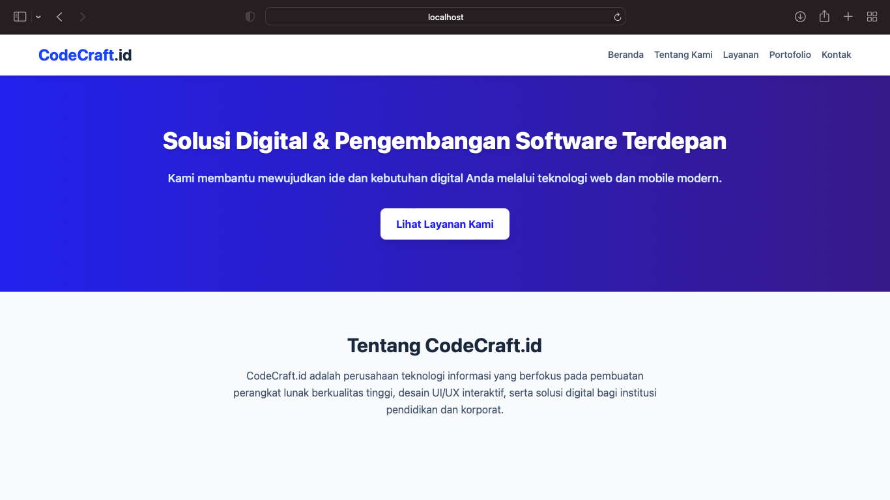
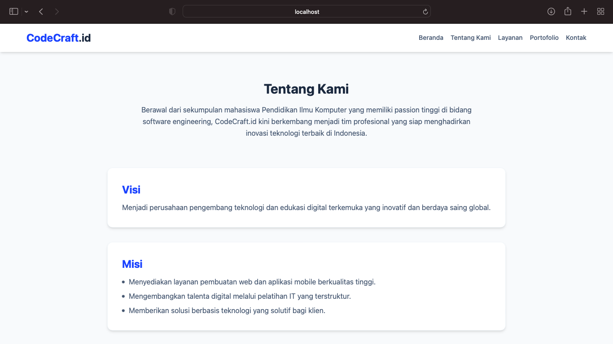
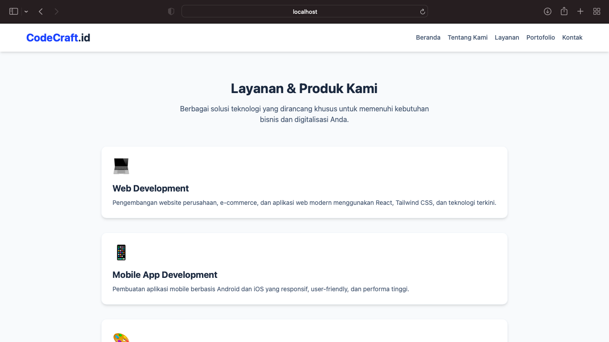
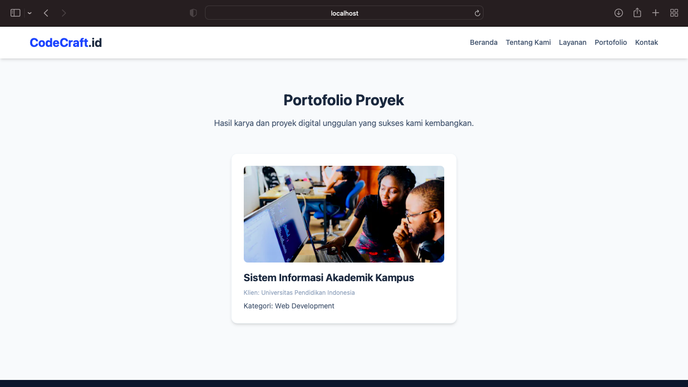
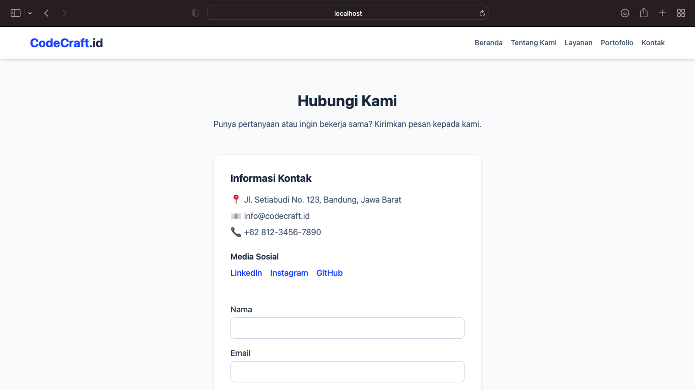

# Company Profile - CodeCraft.id

Website *company profile* ini dibuat untuk memenuhi tugas mata kuliah Pemrograman Internet / Praktikum Pemrograman Web bertema Pendidikan Ilmu Komputer.

## Identitas Pembuat
- **Nama:** Aisya Shana Kaylila
- **NIM:** [Masukkan NIM Kamu di Sini]
- **Kelas:** [Masukkan Kelas Kamu di Sini]

## Deskripsi Singkat
**CodeCraft.id** adalah platform digital dan *software house* fiktif yang berfokus pada penyedia solusi pembuatan perangkat lunak, aplikasi mobile, serta edukasi berbasis teknologi informasi bagi institusi pendidikan maupun korporat. Website ini dibangun menggunakan **React, Vite, Tailwind CSS, dan React Router DOM**.

## Cara Menjalankan Project
Pastikan komputer kamu sudah terinstal **Node.js**, lalu jalankan perintah berikut di terminal:

1. Clone repository atau ekstrak folder project ke komputer.
2. Buka terminal pada direktori project, lalu instal dependensi dengan perintah:
   ```bash
   npm install

## Screenshot Halaman Website

### 1. Beranda


### 2. Tentang Kami


### 3. Layanan


### 4. Portofolio


### 5. Kontak
